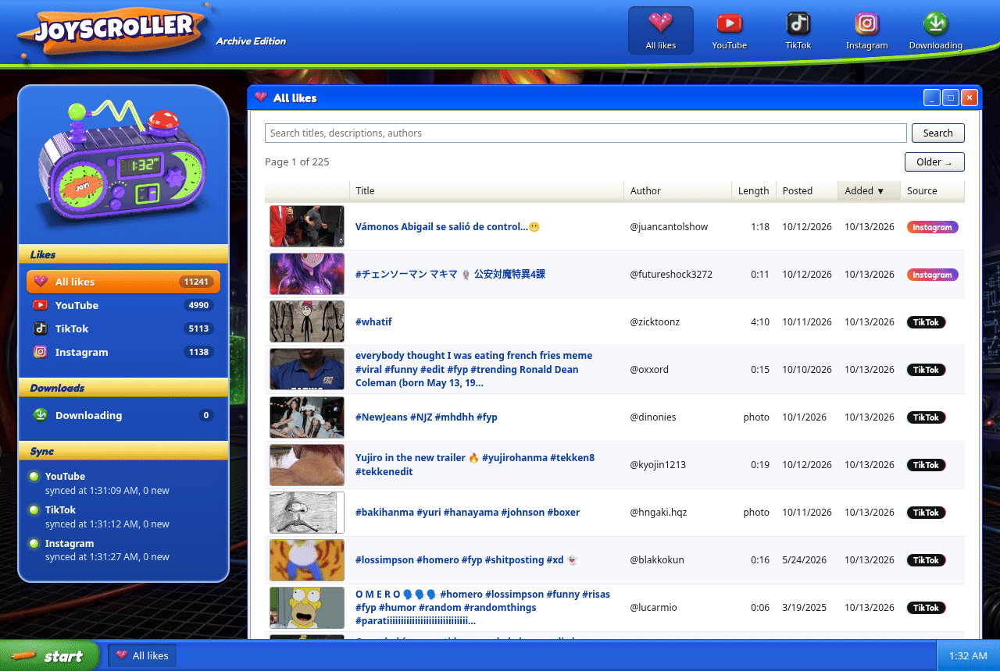

# Joyscroller



## What it is

Joyscroller keeps a permanent copy of every video you've liked, so a like never disappears when the platform hides it, deletes it, or buries it in an endless feed. It covers YouTube and TikTok likes, and the videos you've saved on Instagram (Instagram's bookmark is what keeps a post, so saves are what Joyscroller archives there).

It runs on your own computer and signs in with the browser you already use: it reads your login cookies straight from your browser's profile, so there's no account to connect. Every five minutes it saves your new likes to a local database, and a page on localhost lets you browse them. New likes show up on that page as soon as they're saved. For TikTok and Instagram it briefly runs your browser headless in the background, with a separate throwaway profile, and asks for your list from inside the site's own page: TikTok only answers requests made from there.

Downloading each video at the best quality available is built, and will be switched back on in the app soon.

## How to get it and run it

There are no prebuilt releases yet, so you build it from source. You need:

- Linux
- Brave, signed in to YouTube, TikTok and Instagram in its `Default` profile, with `brave` on your `PATH`
- A desktop keyring (gnome-keyring or KWallet), where Brave keeps the key to its cookies
- [yt-dlp](https://github.com/yt-dlp/yt-dlp) on your `PATH`
- A recent stable [Rust](https://rustup.rs) toolchain

From a copy of the source:

```sh
cargo install --path .
joyscroller
```

Then open **http://127.0.0.1:4774** in your browser. Leave `joyscroller` running: it syncs right away and then every five minutes. Stop it with Ctrl-C.

Your archive lives in `~/.local/share/joyscroller/joyscroller.db`.

## Developers

```sh
cargo run
```

Then open **http://127.0.0.1:4774**. That runs against your real archive. To experiment without touching it, point the app at a throwaway data directory:

```sh
XDG_DATA_HOME=/tmp/joyscroller-dev cargo run
```

The debugging subcommands (`likes`, `sync`, `download`, `cookies`) are listed in [AGENTS.md](AGENTS.md). The `download` command also needs `ffmpeg` and `ffprobe` on your `PATH`.

Run `just precommit` before every commit. [CONTRIBUTING.md](CONTRIBUTING.md) has the conventions, and [AGENTS.md](AGENTS.md) has the architecture and data model.
